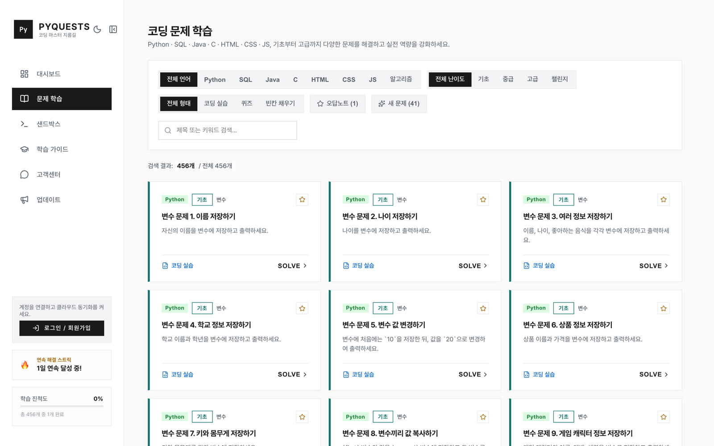
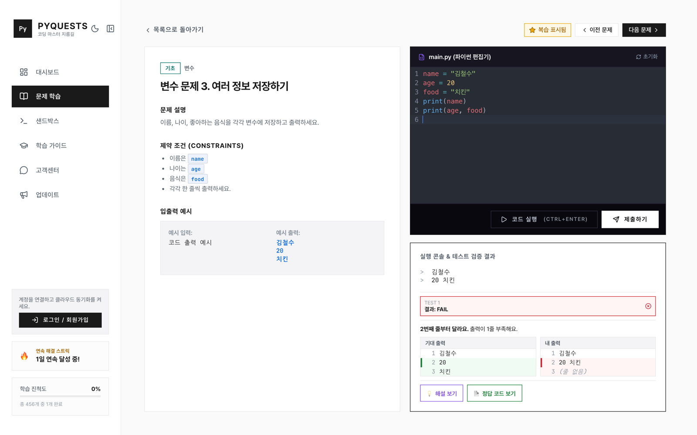
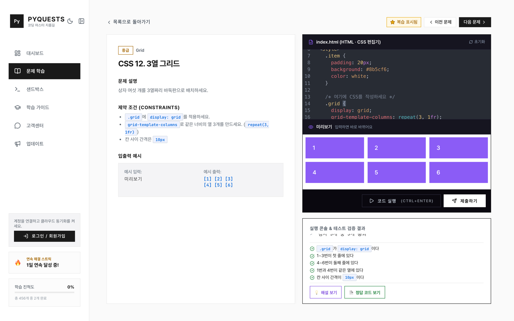
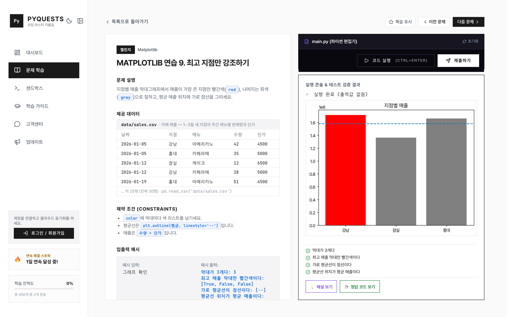

# PyQuests

**설치 없이, 브라우저에서 바로 코딩을 배우고 연습해요.**

문제를 풀면 코드가 그 자리에서 실행되고, 막히면 학습 가이드에서 개념을 찾아볼 수 있어요.

 

 

  

---

## ✨ 이런 걸 할 수 있어요

<table>
  <tr>
    <td width="50%" valign="top">
      
      <h3>🔍 어디가 틀렸는지 알려 줘요</h3>
      기대 출력과 내 출력을 나란히 보여 주고, <code>88</code>과 <code>88.0</code>, 따옴표, 띄어쓰기처럼 흔한 원인을 짚어 줘요.
    </td>
    <td width="50%" valign="top">
      
      <h3>🎨 쓰는 대로 바뀌는 HTML · CSS</h3>
      VS Code Live Server처럼 입력하면 미리보기가 바로 바뀌고, 완성된 화면을 검사해서 채점해요.
    </td>
  </tr>
  <tr>
    <td width="50%" valign="top">
      
      <h3>📊 실제 데이터로 분석하고 그래프 그리기</h3>
      학생 성적 · 카페 매출 · 날씨 CSV를 Pandas로 읽고, Matplotlib 그래프를 한글 그대로 그려요.
    </td>
    <td width="50%" valign="top">
      <h3>⚡ 실전 문제와 효율성 테스트</h3>
      코딩 테스트처럼 풀이 방법을 알려 주지 않는 이야기형 문제예요. 답이 맞아도 입력이 커졌을 때 너무 느리면 알려 줘요.
        
      <h3>📚 학습 가이드 86장</h3>
      장마다 예제와 이해도 체크 퀴즈가 있고, Python · SQL 예제는 가이드 안에서 바로 실행해 볼 수 있어요.
        
      <h3>📱 앱처럼 설치</h3>
      휴대폰 · PC 홈 화면에 추가해서 쓰고, 새 버전이 나오면 알려 줘요.
    </td>
  </tr>
</table>

---

## 🧩 문제 456개

| 언어 | 문제 | 풀이 방식 |
|:---|---:|:---|
| 🐍 **Python** | 173 | 코드를 직접 실행 · NumPy · Pandas · Matplotlib 포함 |
| 🧠 **알고리즘** | 77 | 함수를 작성해 여러 입력으로 채점 · 실전 문제는 효율성 테스트까지 |
| 🗄️ **SQL** | 36 | 쿼리를 직접 실행하고 결과를 표로 확인 |
| 🟨 **JavaScript** | 36 | 코드 실행 · 객관식 · 빈칸 |
| 🌐 **HTML** | 18 | 실시간 미리보기 · 완성된 화면으로 채점 |
| 🎨 **CSS** | 20 | 실시간 미리보기 · 완성된 화면으로 채점 |
| ☕ **Java** | 48 | 객관식 · 빈칸 |
| ⚙️ **C** | 48 | 객관식 · 빈칸 |

난이도는 **기초 → 중급 → 고급 → 챌린지** 네 단계예요. 해설 · 정답 코드 · 틀린 문제를 모아 보는 **오답노트**가 있어요.

---

## 🙋 그 밖에

- **🧪 샌드박스** — 문제와 상관없이 자유롭게 코드를 실행해 보는 곳
- **🏆 진도와 랭킹** — 로그인하면 푼 문제와 연속 학습 기록이 저장되고 랭킹에 올라가요. 로그인하지 않아도 문제는 모두 풀 수 있어요.
- **🏫 공용 컴퓨터 모드** — 학교 · 도서관 컴퓨터에서 로그인할 때 선택하면 브라우저를 닫을 때 로그아웃돼요. 모드와 상관없이 1시간 동안 쓰지 않으면 자동으로 로그아웃돼요.

---

## ⚙️ 어떻게 동작하나요

> **작성한 코드는 서버로 보내지 않아요.** 모든 코드는 내 브라우저 안에서 실행되고 채점돼요.

| | 실행기 |
|:---|:---|
| Python | **Pyodide** — WebAssembly로 만든 Python |
| SQL | **sql.js** (SQLite) — Oracle 문법 일부도 받아 줘요 |
| JavaScript | 격리된 **Web Worker** |
| HTML · CSS | 스크립트가 실행되지 않는 **미리보기 화면** |

한 번 불러온 뒤에는 빠르게 실행되고, 끝나지 않는 반복문을 써도 일정 시간이 지나면 멈춰서 화면이 멈추지 않아요.

### 🔒 저장하는 정보

로그인한 경우에만 **닉네임, 푼 문제, 오답노트, 학습 가이드 진도와 퀴즈 답, 고객센터 문의글**을 저장해요. 문제를 풀며 작성한 코드는 저장하지 않아요. (샌드박스 코드는 내 브라우저에만 남아요.)

---

## 🛠️ 만든 기술

  
  
  
  
  
  
  
  
  

개발 환경, 검증 스크립트, 구조는 **[docs/development.md](docs/development.md)** 에 있어요.
